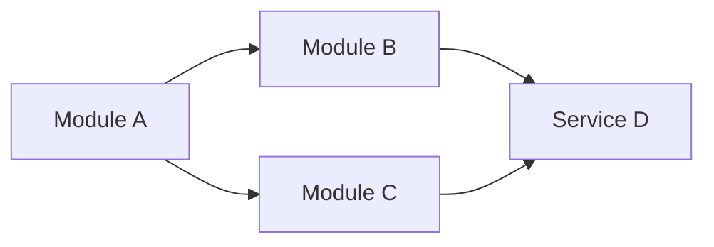

# Guide : graphique explicatif

Génère un graphique SVG ou Mermaid pour clarifier une portion de code complexe : structure de données, hiérarchie de classes, relation entre modules, algorithme non trivial.

## Quand générer un graphique

- Plus de 3 entités en relation et la relation est implicite dans le code.
- Une structure de données récursive ou imbriquée.
- Une hiérarchie d'héritage ou de composition non évidente.
- Un algorithme avec plusieurs branches ou cas particuliers.

**Ne pas générer** pour : une fonction linéaire, un CRUD simple, un changement de signature, une refactorisation purement cosmétique.

## Choix du format

| Type de schéma | Format recommandé |
|---|---|
| Diagramme de classes | Mermaid (`classDiagram`) |
| Relations entre modules / dépendances | Mermaid (`graph LR` ou `graph TD`) |
| Structure de données arborescente | Mermaid (`graph TD`) |
| Schéma libre, illustration métier | SVG manuel |

Privilégie Mermaid quand c'est possible : c'est plus lisible en review GitHub/GitLab et plus facile à éditer.

## Format Mermaid : génération

Crée un fichier `.md` dans le répertoire dev-notes contenant un bloc Mermaid :

````markdown
# <Titre du schéma>


````

Nomme le fichier de manière explicite : `module-dependencies.md`, `auth-class-hierarchy.md`, etc.

## Format SVG : génération

Si Mermaid ne suffit pas, génère un SVG inline simple. Limite-toi aux primitives :

- `<rect>`, `<circle>`, `<ellipse>` pour les nœuds
- `<line>`, `<path>` pour les relations
- `<text>` pour les labels

**Conventions visuelles** :

- Fond blanc ou transparent.
- Texte en `font-family: sans-serif`, taille 12-14.
- Couleur de trait `#333` pour les éléments principaux, `#999` pour les éléments secondaires.
- Pas de surcharge décorative : un schéma de doc, pas une infographie marketing.

Exemple minimal :

````svg
<svg xmlns="http://www.w3.org/2000/svg" viewBox="0 0 400 200" width="400" height="200">
  <rect x="20" y="50" width="120" height="60" fill="white" stroke="#333" stroke-width="2"/>
  <text x="80" y="85" text-anchor="middle" font-family="sans-serif" font-size="14">Module A</text>
  <rect x="260" y="50" width="120" height="60" fill="white" stroke="#333" stroke-width="2"/>
  <text x="320" y="85" text-anchor="middle" font-family="sans-serif" font-size="14">Module B</text>
  <line x1="140" y1="80" x2="260" y2="80" stroke="#333" stroke-width="2" marker-end="url(#arrow)"/>
  <defs>
    <marker id="arrow" viewBox="0 0 10 10" refX="9" refY="5" markerWidth="6" markerHeight="6" orient="auto">
      <path d="M0,0 L10,5 L0,10 z" fill="#333"/>
    </marker>
  </defs>
</svg>
````

## Référencement depuis dev-notes.md

Dans la section « Visuels » de `dev-notes.md`, ajoute :

````markdown
- [Hiérarchie de classes du module d'authentification](./auth-class-hierarchy.md)
- [Dépendances entre services](./service-dependencies.md)
````

## Qualité avant de livrer

- [ ] Le graphique apporte une info que le texte seul ne donnerait pas aussi clairement.
- [ ] Les labels sont lisibles et non tronqués.
- [ ] Pas plus de ~10 entités par schéma — sinon découpe en plusieurs.
- [ ] Le fichier est référencé depuis `dev-notes.md`.
